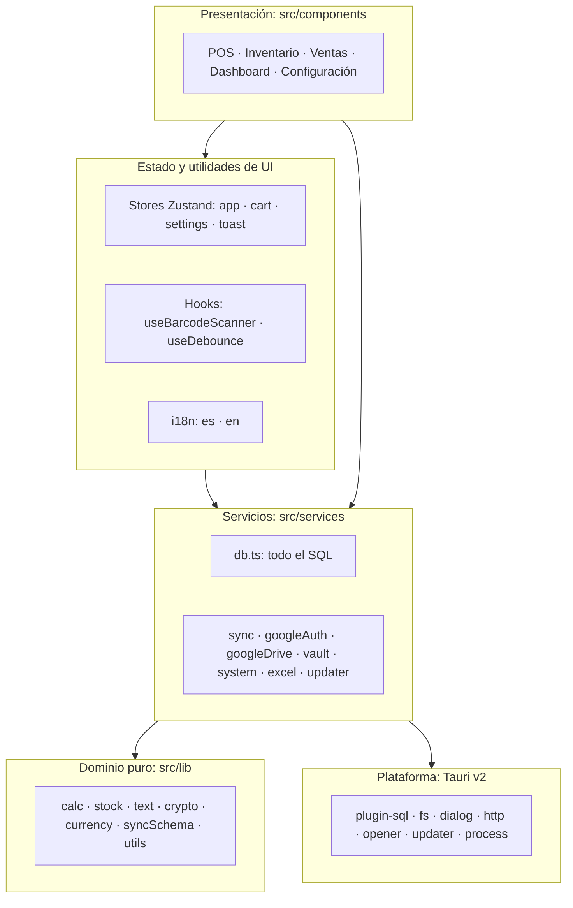
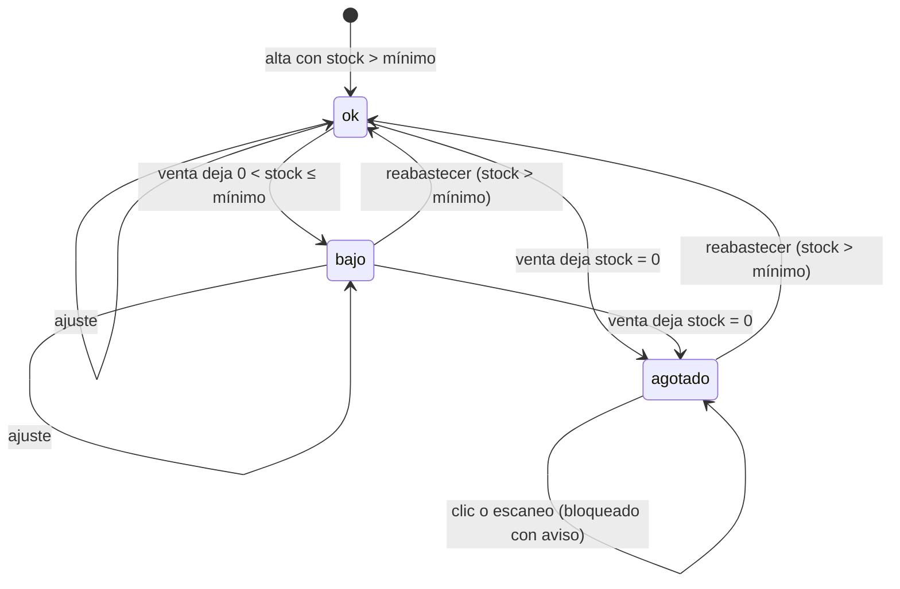
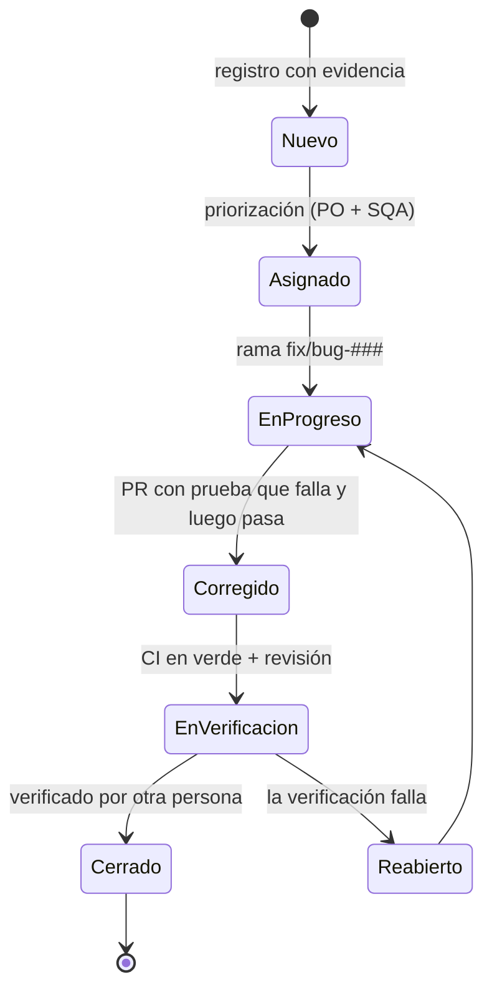
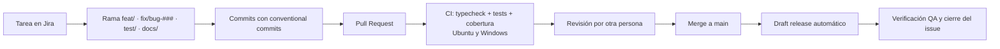
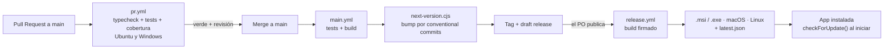
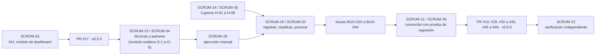

# UNIVERSIDAD MARIANO GÁLVEZ DE GUATEMALA

**Facultad de Ingeniería en Sistemas de Información, Plan Sábado**
**Curso:** 0900-048 Aseguramiento de la Calidad de Software (sábados 16:00 a 18:00, CC-28)
**Catedrático:** Hernán Velásquez

## Implementación Integral de Aseguramiento de Calidad en un Producto de Software usando SCRUM

**Sistema bajo prueba:** Librería POS (punto de venta e inventario)
**Repositorio:** https://github.com/box-bm/local-stationery-store

| Integrante | Carnet | Rol SCRUM / QA |
|---|---|---|
| Brandon Gerardo Manzo Godoy | 0900-18-502 | Product Owner, Arquitecto, Líder Técnico |
| María José Mauricio Ramírez | 0900-22-7501 | Scrum Master, SQA |
| Antony Josué Toribio Pérez | 0900-22-11654 | QA Automatización |
| Josue Daniel Camey Camey | 0900-19-4828 | QA (diseño y ejecución manual) |
| Jonathan Camilo Castillo Méndez | 0900-22-8408 | Dev |

Guatemala, octubre de 2026

---

## Contenido

1. [Introducción](#1-introducción)
2. [Objetivos](#2-objetivos)
3. [Contexto del proyecto](#3-contexto-del-proyecto)
4. [Funcionalidad trabajada: Dashboard de ventas](#4-funcionalidad-trabajada-dashboard-de-ventas)
5. [Stack de tecnología y arquitectura](#5-stack-de-tecnología-y-arquitectura)
6. [Herramientas de trabajo](#6-herramientas-de-trabajo)
7. [Sprint 1: atributos de calidad y métricas](#7-sprint-1-atributos-de-calidad-y-métricas)
8. [Sprint 2: definición de pruebas](#8-sprint-2-definición-de-pruebas)
9. [Sprints 3 y 4: identificación de errores y pruebas realizadas](#9-sprints-3-y-4-identificación-de-errores-y-pruebas-realizadas)
10. [Cómo se llevó el desarrollo y QA](#10-cómo-se-llevó-el-desarrollo-y-qa)
11. [Despliegue: workflow de CI/CD](#11-despliegue-workflow-de-cicd)
12. [Relación entre tareas, historias de usuario e issues](#12-relación-entre-tareas-historias-de-usuario-e-issues)
13. [Costo de las horas trabajadas](#13-costo-de-las-horas-trabajadas)
14. [Dashboard de métricas de calidad](#14-dashboard-de-métricas-de-calidad)
15. [Conclusiones ejecutivas](#15-conclusiones-ejecutivas)
16. [Recomendaciones de mejora continua](#16-recomendaciones-de-mejora-continua)
17. [Lecciones aprendidas del equipo SCRUM](#17-lecciones-aprendidas-del-equipo-scrum)
18. [Nota de uso de IA](#18-nota-de-uso-de-ia)
19. [Anexos](#19-anexos)

---

## 1. Introducción

Una aplicación de punto de venta trabaja con dos cosas que no admiten errores: el dinero y el inventario. Un cobro mal validado o un stock que queda en negativo se traducen en pérdidas reales para el negocio. Por esa razón, el equipo eligió Librería POS como producto para aplicar el ciclo completo de aseguramiento de calidad visto en el curso. Es una aplicación de escritorio real, en uso, desarrollada por uno de los integrantes, sobre la que además se construyó un módulo nuevo: el **Dashboard de ventas**.

El proyecto se ejecutó con SCRUM en cuatro sprints semanales y un cierre, del 21 de septiembre al 17 de octubre de 2026. En ese periodo se definieron el backlog, los roles, la arquitectura y los atributos de calidad. También se diseñaron 43 casos de prueba con las técnicas obligatorias y 25 combinaciones pairwise. Se registraron y corrigieron 19 bugs reales, se automatizaron 71 pruebas de caja negra con Cypress y la suite de caja blanca pasó de 33 a 174 pruebas unitarias. La cobertura de líneas subió de 17.55 % a 95.2 %. Cada corrección se integró a producción mediante un pipeline de CI/CD que valida, versiona y publica los instaladores.

Este documento consolida ese trabajo, detalla cómo se relacionan los errores con sus issues, pruebas y correcciones, y presenta las métricas, el costo estimado del esfuerzo y las conclusiones del equipo.

## 2. Objetivos

### 2.1 Objetivo general

Aplicar un proceso integral de aseguramiento de calidad bajo SCRUM sobre Librería POS v0.5.0 y su nuevo módulo Dashboard, para verificar que el sistema maneja dinero y stock con exactitud. El proceso combina técnicas estáticas y dinámicas, pruebas manuales y automatizadas, y gestión profesional de defectos.

### 2.2 Objetivos específicos

- Definir el backlog, los roles, la arquitectura, los atributos de calidad (ISO/IEC 25010) y las métricas del proyecto.
- Diseñar casos de prueba con clases de equivalencia, valores límite, tabla de decisión, pairwise y transición de estados, priorizados por riesgo.
- Ejecutar pruebas manuales y automatizadas para identificar, registrar y clasificar defectos como error, defecto o fallo.
- Gestionar el ciclo de vida de cada bug, desde su registro hasta su verificación, con una prueba que primero falle y luego pase.
- Automatizar la regresión del flujo crítico de venta con Cypress y elevar la cobertura de caja blanca con Vitest.
- Integrar las pruebas a un pipeline de CI/CD que impida liberar código que no las supere.

## 3. Contexto del proyecto

### 3.1 El sistema bajo prueba

**Librería POS** es una aplicación de escritorio *offline-first* de punto de venta e inventario para una librería en Guatemala. Funciona sin conexión con una base de datos SQLite local y, de forma opcional, sincroniza una copia de la base con Google Drive.

Su concepto central son las **unidades dinámicas**. Un producto se compra en bloque (por ejemplo, una resma de 500 hojas), pero se vende de varias formas con distinto precio: hoja a Q0.25, 4 hojas a Q1.00 o resma completa a Q35.00. El stock siempre se mide en unidades base y cada venta descuenta `quantity_in_base_units × cantidad`. Este diseño introduce fracciones (una hoja equivale a 0.002 resmas) y fue una de las principales fuentes de riesgo identificadas.

| Módulo | Funcionalidad principal |
|---|---|
| Punto de venta | Búsqueda con autocompletado, filtro por categorías, lector de código de barras, selección de unidad y cantidad, carrito, cobro en efectivo o transferencia, cliente opcional, recibo |
| Inventario | Tabla de productos, alertas de stock (bajo y agotado), alta y edición con múltiples unidades de venta, reabastecimiento, ajuste de stock, exportación a Excel |
| Ventas | Historial paginado, filtros por fecha, detalle por venta, resumen de ganancias, exportación a Excel |
| Dashboard (nuevo en v0.5.0) | KPIs, filtros por fecha, producto, método de pago y cliente, cuatro tipos de gráfico, productos más vendidos |
| Configuración | Idioma (es/en), tema, moneda, métodos de pago, nombre del negocio, respaldos, bloqueo con contraseña, sincronización con Google Drive, actualizaciones |

### 3.2 Versiones

| Versión | Fecha | Rol en el proyecto |
|---|---|---|
| v0.4.0 | Previa al proyecto | Línea base fijada en el Sprint 1 para comparar |
| v0.5.0 | 6 de octubre de 2026 | Versión bajo prueba: incorpora el módulo Dashboard (PR #17) |
| v0.6.0 | 15 de octubre de 2026 | Versión final: incluye las correcciones de los 19 bugs registrados |

### 3.3 Equipo y principio de independencia

Los roles se asignaron según el enunciado del curso (SM, PO, QA, SQA, Dev, Líder Técnico y Arquitecto). Brandon Manzo es el autor del código, por eso no actuó como QA ni como SQA. Cada corrección fue verificada por una persona distinta a quien la implementó, tal como establece el plan de pruebas.

| Integrante | Rol | Responsabilidad principal |
|---|---|---|
| Brandon Manzo | PO, Arquitecto, Líder Técnico | Backlog, arquitectura, diagrama de estados, priorización de bugs, revisión de PRs, correcciones |
| María José Mauricio | Scrum Master, SQA | Ceremonias, plan de pruebas, ciclo de vida de los bugs, métricas, consolidación de evidencias |
| Antony Toribio | QA Automatización | Diseño de casos, estrategia de automatización, suite Cypress e integración con Qase |
| Josue Camey | QA (diseño y ejecución manual) | Plan de pruebas, ejecución, registro y clasificación de bugs, reporte de hallazgos |
| Jonathan Castillo | Dev | Módulo Dashboard, corrección de defectos, pruebas de caja blanca |

### 3.4 Calendario de sprints

| Sprint | Fechas | Objetivo | Review |
|---|---|---|---|
| 1 | 21 a 27 sep | Preparación: backlog, roles, arquitectura, atributos de calidad, métricas, línea base de cobertura, spike de E2E | 25 sep |
| 2 | 28 sep a 4 oct | Diseño de pruebas: técnicas, casos, pairwise, plan de pruebas | 2 oct |
| 3 | 5 a 11 oct | Ejecución manual, registro y gestión de bugs, depuración | 9 oct |
| 4 | 12 a 16 oct | Automatización, caja blanca, corrección y regresión de bugs | 16 oct |
| Entrega | 17 oct | Entrega del proyecto | |

## 4. Funcionalidad trabajada: Dashboard de ventas

### 4.1 Objetivo del módulo

Antes de este proyecto, el dueño de la librería solo podía consultar sus ventas como un listado en la pantalla de Ventas. El Dashboard agrega una vista ejecutiva para responder de un vistazo cuánto se vendió, cuánto se ganó y qué productos se mueven más en un periodo. Corresponde a la historia de usuario SCRUM-33 del backlog. Es el módulo nuevo de la versión v0.5.0 y, por ser código recién escrito y sin historial de uso, se clasificó como un área de riesgo **alto** (RP-05) en el plan de pruebas.

### 4.2 Funcionalidades

| Elemento | Descripción |
|---|---|
| Rango de fechas | Campos «Desde» y «Hasta» con calendario propio; por defecto, el mes actual |
| Filtros | Producto, método de pago y cliente, combinables entre sí |
| KPIs | Número de ventas, ingresos y ganancia del periodo, con animación de conteo |
| Gráfico de ventas por periodo | Cuatro tipos seleccionables: barras, líneas, circular y dona |
| Productos más vendidos | Ranking por unidades vendidas con barra proporcional |
| Idioma | Textos tomados del sistema de traducciones es/en de la aplicación |

### 4.3 Evolución del módulo durante el proyecto

| Momento | Cambio | Referencia |
|---|---|---|
| 6 oct | Primera versión del módulo (pantalla, consultas en `db.ts`, traducciones, menú lateral). Se publica como v0.5.0 | PR #17 |
| Sprint 2 | Revisión estática del código al preparar el modelo pairwise: se documentan 6 observaciones (O-1 a O-6) | S2-PW-001 |
| Sprint 3 | La ejecución manual confirma las observaciones y se registran BUG-039 a BUG-042; la revisión del código origina BUG-028 | Issues #28, #39 a #42 |
| 13 oct | «Dashboard corregido»: textos con i18n, gráfico correcto por botón, calendario y mensajes de validación en Inventario | PR #19 |
| 15 oct | Corrección de la consulta de productos más vendidos con rango de fechas | PR #34 (BUG-028) |
| 15 oct | Validación del rango de fechas y eliminación de los datos de ejemplo | PR #47 (BUG-040, BUG-041) |
| 15 oct | Pruebas unitarias del módulo (`DashboardScreen.test.tsx`, 5 pruebas) | v0.6.0 |

Las observaciones de la revisión estática fueron las siguientes:

| # | Observación | Resultado |
|---|---|---|
| O-1 | Los textos de la pantalla estaban fijos en un diccionario en ruso | Confirmado: BUG-039 |
| O-2 | Cada botón de gráfico dibujaba otro tipo (Barras → Dona, Líneas → Barras, etc.) | Confirmado: BUG-042 |
| O-3 | Sin ventas, el gráfico mostraba datos de ejemplo fijos | Confirmado: BUG-041 |
| O-4 | La consulta de productos más vendidos duplicaba el prefijo de la columna (`s.s.created_at`) | Confirmado: BUG-028 |
| O-5 | El gráfico circular repartía los sectores sobre 120 % y se dibujaba rotado | Corregido dentro del PR #19 |
| O-6 | El filtro de método de pago ofrece «Tarjeta», que ya no existe en el cobro | No registrado como bug; queda como recomendación |

## 5. Stack de tecnología y arquitectura

### 5.1 Stack

| Capa | Tecnología |
|---|---|
| Shell de escritorio | Tauri v2 (Rust); comandos propios solo para el keyring del sistema operativo |
| Frontend | React 18 + TypeScript + Vite |
| UI | Tailwind CSS + primitivas estilo shadcn/ui |
| Estado | Zustand (stores `app`, `cart`, `settings`, `toast`) |
| Formularios | React Hook Form + Zod |
| Persistencia | SQLite local (`libreria.db`) vía `@tauri-apps/plugin-sql`, esquema v6 |
| Exportación | SheetJS (`.xlsx`) |
| Sincronización | Google Drive (OAuth Device Authorization Grant), opcional |
| Actualizaciones | `tauri-plugin-updater` contra GitHub Releases |
| Pruebas de caja blanca | Vitest + `@vitest/coverage-v8` + Testing Library + jsdom + sql.js |
| Pruebas de caja negra | Cypress 13 con el IPC de Tauri simulado + `cypress-qase-reporter` |
| CI/CD | GitHub Actions |
| Plataforma destino | Windows (instaladores también para macOS y Linux) |

### 5.2 Capas

La arquitectura sigue tres principios. Todo el SQL vive en `src/services/db.ts`, la lógica de negocio pura vive en `src/lib/` sin depender de Tauri, y los servicios envuelven las APIs de Tauri para poder reemplazarlas en las pruebas. Esto fue lo que permitió probar la capa de datos con SQLite real en memoria.

### 5.3 Puntos de atención para QA definidos en la arquitectura

El documento de arquitectura (`docs/arquitectura/ARQUITECTURA.md`) identificó desde el Sprint 1 las características que debían cubrirse con casos de prueba. Varias de ellas terminaron confirmadas como bugs:

| Característica de la arquitectura | Resultado |
|---|---|
| `completeSale` descuenta stock sin validar existencia | Confirmado: BUG-022 (stock negativo) |
| La venta guarda la fecha en UTC y los reportes filtran con la fecha local | Confirmado: BUG-027 |
| `quantity_in_base_units` es `REAL` (fracciones) | Cubierto por pruebas de redondeo; sin defecto |
| `completeSale` ejecuta varias escrituras sin transacción | Mitigado: desde el PR #49 el stock se valida antes de escribir; la transacción queda como recomendación |
| Textos sin traducir en pantallas nuevas (Dashboard v0.5.0) | Confirmado: BUG-039 |

## 6. Herramientas de trabajo

| Área | Herramienta | Uso en el proyecto |
|---|---|---|
| Planificación y backlog | Jira (proyecto SCRUM) | Sprints, tareas, historias, subtareas, tablero y reportes de cycle time y lead time |
| Registro de bugs | GitHub Issues | Un issue por bug (BUG-###) con labels de severidad, prioridad, clasificación, área y sprint |
| Código y revisión | GitHub (branches y Pull Requests) | Ramas `feat/`, `fix/bug-###`, `test/`, `docs/`; PR con revisión obligatoria |
| Integración y despliegue | GitHub Actions | Pipeline de PR, de `main` y de release (sección 11) |
| Gestión de casos y ejecuciones | Qase TestOps (proyecto QLP) | Catálogo de casos, test runs automáticos con videos y capturas |
| Caja blanca | Vitest + cobertura v8 + Testing Library | Pruebas unitarias y de integración con SQLite en memoria (sql.js) |
| Caja negra / E2E | Cypress 13 | Suite del Punto de venta con el IPC de Tauri simulado |
| Pairwise | Algoritmo all-pairs (tipo AETG) y Microsoft PICT | Generación y contraste de los 25 casos combinatorios |
| Documentación | Word / Google Docs, Markdown en el repositorio | Plan de pruebas, casos, pairwise, reportes de hallazgos, arquitectura, guía del equipo |
| Diagramas | Mermaid | Arquitectura, flujos, estados y pipeline |
| Evidencias | Capturas y videos de Cypress, capturas manuales | Convención `S<sprint>_<tipo>_<id>_<descripcion>.<ext>` |

**Convenciones del equipo.** Commits con prefijos `feat:`, `fix:`, `test:` y `docs:` (conventional commits), que el pipeline usa para calcular la versión. IDs de casos `TC-<MOD>-###` (POS, INV, VEN, CFG, DSH), de bugs `BUG-###` y de hipótesis automatizadas `H-##`.

**Labels de GitHub.**

| Grupo | Valores |
|---|---|
| Tipo | `bug`, `story`, `test`, `docs` |
| Severidad | `sev:critica`, `sev:alta`, `sev:media`, `sev:baja` |
| Prioridad por riesgo | `prio:P1`, `prio:P2`, `prio:P3` |
| Clasificación | `clase:error`, `clase:defecto`, `clase:fallo` |
| Área | `area:pos`, `area:inv`, `area:ven`, `area:dashboard`, `area:cfg` |
| Sprint | `sprint:1` a `sprint:4` |

## 7. Sprint 1: atributos de calidad y métricas

### 7.1 Atributos de calidad (ISO/IEC 25010)

| Característica | Subcaracterística | Cómo se verifica |
|---|---|---|
| Adecuación funcional | Completitud, corrección | Casos funcionales por módulo; exactitud de totales, cambio, stock y KPIs |
| Fiabilidad | Madurez, recuperabilidad | Persistencia tras reinicio, respaldo y restauración, ventas sin estados parciales |
| Usabilidad | Protección contra errores, operabilidad | Bloqueo de cantidades inválidas, mensajes claros, flujo con teclado y lector |
| Seguridad | Confidencialidad | Contraseña de bloqueo; token OAuth fuera de `localStorage` |
| Mantenibilidad | Capacidad de prueba, modularidad | Cobertura de Vitest y suite de regresión automatizada |
| Portabilidad | Instalabilidad, adaptabilidad | Instalador en Windows 10 y 11; pantallas angostas |

### 7.2 Métricas seleccionadas

| Métrica | Fórmula o fuente | Meta |
|---|---|---|
| Cobertura de código | `vitest --coverage` (líneas, ramas) | ≥ 85 % líneas, ≥ 80 % ramas |
| Cobertura de requisitos | Casos con prueba / casos diseñados | 100 % de las áreas de alto riesgo |
| Casos aprobados | Aprobados / ejecutados | ≥ 90 % al cierre |
| Densidad de defectos | Bugs por módulo | Seguimiento |
| Distribución por severidad | Conteo por label `sev:*` | 0 críticos abiertos |
| Eficiencia de remoción (DRE) | Bugs corregidos y verificados / bugs totales | ≥ 70 % |
| Tasa de reapertura | Bugs reabiertos / bugs cerrados | ≤ 10 % |
| Tiempo medio de corrección | Fecha de cierre menos fecha de apertura | Seguimiento |
| Velocidad del equipo | Tareas completadas por sprint (Jira) | Seguimiento |

### 7.3 Línea base de cobertura

En el Sprint 1 se midió la cobertura de la versión de partida (commit `6dd57bc`, antes de las pruebas nuevas): **7 archivos de prueba, 33 pruebas y 17.55 % de líneas** (57.25 % de ramas, 36.36 % de funciones). Los módulos críticos `db.ts`, `sync.ts`, `googleAuth.ts`, `googleDrive.ts` y los stores `app` y `toast` tenían 0 % de cobertura. El resultado final se presenta en la sección 9.4.

### 7.4 Decisión del spike de E2E

Se evaluaron dos alternativas para automatizar la caja negra: Cypress contra el frontend con el IPC de Tauri simulado (`mockIPC`), o `tauri-driver` con Selenium. Se eligió **Cypress con el IPC simulado**. Para que la simulación no ocultara defectos reales, el *mock* crea una base SQLite en memoria con las **migraciones reales** del sistema, de modo que las consultas SQL ejecutadas son las mismas de la aplicación. La limitación (no se prueba el instalador ni la persistencia en disco) se cubrió con pruebas manuales sobre la aplicación instalada.

### 7.5 Rendimiento

La rúbrica menciona JMeter. El plan de pruebas lo deja fuera de alcance con justificación: Librería POS es una aplicación de escritorio monousuario sin servicios HTTP propios, por lo que no existe un servidor sobre el cual medir carga o concurrencia.

## 8. Sprint 2: definición de pruebas

### 8.1 Estrategia y plan de pruebas (S2-PP-001)

El plan se redactó siguiendo la estructura de IEEE 829 y define alcance, estrategia, criterios, ambiente, roles, calendario, gestión de defectos, métricas y riesgos. Su eje es un **enfoque basado en riesgos**: el nivel de riesgo se calcula como probabilidad de fallo × impacto en el negocio y determina la prioridad de cada caso y el orden de ejecución.

|  | Impacto bajo | Impacto medio | Impacto alto |
|---|---|---|---|
| **Probabilidad alta** | Medio | Alto | Crítico |
| **Probabilidad media** | Bajo | Medio | Alto |
| **Probabilidad baja** | Bajo | Bajo | Medio |

Crítico y Alto se tratan como P1 (se ejecutan primero y bloquean la liberación), Medio como P2 y Bajo como P3.

**Matriz de riesgos del producto**

| ID | Riesgo | Prob. | Impacto | Nivel | Bugs confirmados |
|---|---|---|---|---|---|
| RP-01 | Sobreventa: el carrito o la venta dejan el stock en negativo | Alta | Alto | Crítico | BUG-020, 021, 022, 023 |
| RP-02 | Cobro con datos de pago incompletos | Alta | Alto | Crítico | BUG-024, 025, 037, 038 |
| RP-03 | Errores de redondeo en unidades fraccionarias | Media | Alto | Alto | Ninguno |
| RP-04 | Reportes con fecha UTC en lugar de la local | Alta | Medio | Alto | BUG-027 |
| RP-05 | Dashboard con datos incorrectos, de ejemplo o en otro idioma | Alta | Medio | Alto | BUG-028, 040, 041, 042 |
| RP-06 | Venta registrada parcialmente (escrituras sin transacción) | Baja | Alto | Medio | Ninguno (mitigado con BUG-022) |
| RP-07 | Pérdida de datos al restaurar un respaldo | Baja | Alto | Medio | Ninguno |
| RP-08 | Textos sin traducir o en otro idioma | Alta | Bajo | Medio | BUG-039 |
| RP-09 | Acceso no autorizado | Media | Medio | Medio | Ninguno |
| RP-10 | Numeración de ventas duplicada tras restaurar | Baja | Medio | Bajo | Ninguno |

**Alcance por módulo**

| Módulo | Riesgo | Casos diseñados |
|---|---|---|
| Punto de venta | Crítico | 16 + 9 pairwise + 63 automatizados |
| Inventario | Alto | 9 |
| Ventas | Medio | 5 |
| Dashboard | Alto | 8 + 16 pairwise |
| Configuración | Medio | 5 |

**Fuera de alcance:** sincronización con una cuenta real de Google Drive (cubierta con pruebas unitarias simuladas), actualizador automático, rendimiento con JMeter, macOS y Linux, núcleo Rust y pruebas de penetración.

**Niveles de prueba**

| Nivel | Objetivo | Herramienta |
|---|---|---|
| Unitario (caja blanca) | Lógica pura: cálculos, stock, carrito, cifrado, textos, i18n | Vitest + cobertura v8 |
| Integración | Consultas SQL de `db.ts` contra el esquema real | Vitest + sql.js |
| Sistema automatizado (caja negra) | Flujos del POS de punta a punta | Cypress 13 + Qase |
| Aceptación | Validar con el PO el comportamiento esperado | Sprint Review |

**Criterios de entrada:** instalador disponible y la app arranca; casos revisados por el SQA y cargados en Qase; ambiente con datos de prueba; prueba de humo superada (carga del POS, búsqueda y venta simple).

**Criterios de salida:** 100 % de los casos P1 y al menos 90 % de los P2 ejecutados; ningún bug crítico abierto; todo bug corregido tiene una prueba que lo reproduce y fue verificado por otra persona; cobertura igual o superior a los umbrales de CI y mayor que la línea base; cada fallo de Cypress asociado a un BUG-###.

**Ambiente:** Windows 11 (principal) y Windows 10, 1366×768 o superior, ventana redimensionable bajo 1024 px; Node.js 20, Vite en el puerto 1420 y Cypress 13 para la automatización. Datos base: Papel bond carta 80g (5 resmas), Lápiz Mongol #2 (10 cajas), Marcador permanente negro (40 unidades), más el juego D-DSH de 7 ventas en 3 fechas para Ventas y Dashboard.

### 8.2 Diseño de casos de prueba (S2-CP-001)

Se diseñaron **43 casos de prueba** en 5 módulos, el triple del mínimo de 12 que exige el curso.

| Módulo | Casos | P1 | P2 | P3 |
|---|---|---|---|---|
| Punto de venta | 16 | 10 | 5 | 1 |
| Inventario | 9 | 3 | 6 | 0 |
| Ventas | 5 | 1 | 2 | 2 |
| Configuración | 5 | 1 | 4 | 0 |
| Dashboard | 8 | 4 | 2 | 2 |
| **Total** | **43** | **19** | **19** | **5** |

| Técnica | N.° | Casos |
|---|---|---|
| Clases de equivalencia | 15 | TC-POS-026, 049, 067, 070; TC-INV-001, 002, 006, 009; TC-VEN-001; TC-CFG-001, 003; TC-DSH-001, 003, 004, 006 |
| Valores límite | 13 | TC-POS-022, 023, 064, 066, 068; TC-INV-003 a 007; TC-VEN-002, 004; TC-CFG-001 |
| Tabla de decisión | 6 | TC-POS-044, 045, 053, 064, 065; TC-CFG-004 |
| Transición de estados | 3 | TC-POS-051; TC-INV-005; TC-CFG-002 |
| Pairwise | 2 | TC-POS-071, TC-DSH-008 (agrupan 25 combinaciones) |
| Adivinación de errores | 1 | TC-INV-008 |
| Prueba de sistema | 7 | TC-POS-069; TC-VEN-003, 005; TC-CFG-005; TC-DSH-002, 005, 007 |

Cada caso documenta ID, módulo, técnica, prioridad, precondiciones, datos de prueba, pasos, resultado esperado y su automatización.

### 8.3 Clases de equivalencia y valores límite

| Variable | Clases válidas | Clases inválidas | Valores límite | Casos |
|---|---|---|---|---|
| Cantidad a vender (modal) | Entero 1 … stock disponible | ≤ 0, no numérica; > stock | 0, 1, stock, stock + 1 | TC-POS-022, 023, 026 |
| Cantidad en el carrito («+») | 1 … stock | > stock | stock, stock + 1 | TC-POS-066 |
| Efectivo recibido | Vacío (opcional); ≥ total | 0 < recibido < total | total − 0.01, total, total + 0.01 | TC-POS-044, 064 |
| Código de autorización | Texto no vacío | Vacío, solo espacios | | TC-POS-045, 065 |
| Precio de venta | ≥ 0 (luego > 0, ver BUG-037) | < 0 | −0.01, 0, 0.01 | TC-INV-003 |
| Fracción de unidad base | > 0 | ≤ 0 | 0, 0.0001, 1 | TC-INV-004 |
| Stock vs. stock mínimo | ok, bajo, agotado | stock < 0 por ajuste | −1, 0, 1, mín, mín + 1 | TC-INV-005, 007 |
| Cantidad a reabastecer | > 0 | ≤ 0 | 0, −2 | TC-INV-006 |
| Contraseña de bloqueo | ≥ 4 caracteres | < 4; confirmación distinta | 3, 4 | TC-CFG-001 |
| Hora de la venta (UTC−6) | 00:00 a 17:59 | | 17:59, 18:00 | TC-POS-068 |
| Ventas por página | | | 25, 26 ventas | TC-VEN-004 |

### 8.4 Tabla de decisión: cobro

| Condición / acción | R1 | R2 | R3 | R4 | R5 | R6 | R7 |
|---|---|---|---|---|---|---|---|
| Hay métodos de pago habilitados | S | S | S | S | S | S | N |
| Método elegido | Efectivo | Efectivo | Efectivo | Transf. | Transf. | Transf. (único) | |
| Efectivo recibido | ≥ total | < total | Vacío | | | | |
| Código de autorización | | | | Con código | Sin código | Con código | |
| **Permitir cobro** | Sí | **No** | Sí | Sí | **No** | Sí | No |
| Mostrar cambio / faltante | Cambio | Faltante | | | | | |
| Mensaje | | Faltante | | | Pide código | Transf. preseleccionada | Activar métodos |
| Caso | TC-POS-044 | TC-POS-064 | TC-POS-043 | TC-POS-045 | TC-POS-065 | TC-CFG-004 | TC-POS-053 |

Las reglas R2 y R5 eran hipótesis de defecto: el sistema permitía cobrar en ambos casos. Se confirmaron como BUG-024 y BUG-025.

### 8.5 Diagrama de transición de estados: stock de un producto

| Estado actual | Evento | Condición | Estado siguiente | Caso |
|---|---|---|---|---|
| ok | Venta | Stock resultante ≤ mínimo y > 0 | bajo | TC-POS-050 |
| ok / bajo | Venta | Stock resultante = 0 | agotado | TC-POS-051 |
| agotado | Clic en el producto | | agotado (bloqueado, aviso) | TC-POS-051 |
| agotado / bajo | Reabastecer | Stock resultante > mínimo | ok | TC-INV-006 |
| cualquiera | Ajustar stock | Nuevo valor | según el valor | TC-INV-005, 007 |
| agotado | Escaneo de su código | | agotado (debería bloquearse) | TC-POS-067 |

La última transición fue la que falló: el lector de código de barras agregaba productos agotados al carrito (BUG-023).

### 8.6 Pairwise testing (S2-PW-001)

| Modelo | Factores | Combinaciones exhaustivas | Casos pairwise | Reducción | Pares cubiertos |
|---|---|---|---|---|---|
| PW-POS: venta completa | 6 | 144 | 9 | 93.8 % | 81 de 81 (100 %) |
| PW-DSH: filtros del Dashboard | 5 | 576 | 16 | 97.2 % | 129 de 129 (100 %) |
| **Total** | | **720** | **25** | **96.5 %** | |

Ambos conjuntos alcanzan el mínimo teórico (3 × 3 = 9 y 4 × 4 = 16).

- **PW-POS:** unidad de venta (base, fracción, paquete), método de pago (efectivo, transferencia), cliente (sin cliente, nuevo, existente), idioma (es, en), tema (claro, oscuro) y pantalla (escritorio, angosta).
- **PW-DSH:** rango de fechas (mes actual, solo hoy, mes anterior, Desde > Hasta), producto (3 valores), método de pago (Todos, Efectivo, Transferencia, Tarjeta), cliente (3 valores) y tipo de gráfico (4 valores).

Las combinaciones se generaron con un algoritmo all-pairs voraz (tipo AETG) y se contrastaron con modelos para Microsoft PICT, incluidos en el anexo de ese documento.

## 9. Sprints 3 y 4: identificación de errores y pruebas realizadas

### 9.1 Fuentes de detección

Los 19 bugs registrados provienen de tres fuentes complementarias:

| Fuente | Técnica | Bugs |
|---|---|---|
| Hipótesis automatizadas (Cypress H-01 a H-08) | Caja negra automatizada, derivada de la revisión del código | 8: BUG-020 a BUG-027 |
| Revisión estática del Dashboard | Técnica estática | 1: BUG-028 |
| Ejecución manual sobre la app instalada | Caja negra manual | 10: BUG-035 a BUG-044 |

La numeración de los issues se asignó en GitHub según el orden de registro del equipo, y los números intermedios no corresponden a bugs.

### 9.2 Pruebas manuales

La ejecución manual se hizo sobre el instalador en Windows, siguiendo los casos por prioridad. Entre las pruebas documentadas con evidencia están:

| Prueba | Resultado |
|---|---|
| Prueba 01: onboarding inicial (5 pasos, Siguiente, Atrás desde el paso 2, Omitir, Comenzar, apertura del POS) | PASSED |
| Inventario: guardar producto sin nombre (campo obligatorio) | PASSED: muestra «El nombre es obligatorio» |
| Inventario: creación de producto con valores correctos | PASSED |
| Inventario: stock inicial negativo | FAILED: BUG-035 |
| Inventario: precio de compra negativo | FAILED: BUG-036 |
| Punto de venta: agregar producto con precio Q0.00 | FAILED: BUG-037 |
| Punto de venta: completar venta con total Q0.00 | FAILED: BUG-038 |
| Dashboard: idioma de los textos | FAILED: BUG-039 |
| Dashboard: rango de fechas inválido | FAILED: BUG-040 |
| Dashboard: filtro sin ventas | FAILED: BUG-041 |
| Dashboard: tipo de gráfico por botón | FAILED: BUG-042 |
| Configuración: símbolo de moneda arbitrario | FAILED: BUG-043 |
| Configuración: nombre del negocio vacío | FAILED: BUG-044 |

Los 4 casos manuales base del POS (QLP-1 carga inicial, QLP-7 búsqueda por nombre, QLP-8 agregar al carrito y QLP-11 disminución de stock) se enlazaron en Qase con su prueba automatizada equivalente.

### 9.3 Pruebas automatizadas de caja negra (Cypress)

La suite vive en la rama `test/e2e-pos-cypress` (carpeta `e2e/`) y cubre el menú Punto de venta, que es el de mayor riesgo. Se ejecuta con `npm run e2e`, que levanta Vite, corre la suite sin interfaz y apaga el servidor. Cada ejecución crea un test run en Qase con el estado de cada caso, videos y capturas de los fallos.

| Spec | Pruebas | Qué cubre |
|---|---|---|
| `01-carga.cy.ts` | 6 | Menú activo, catálogo, marcas de stock, banner de alertas, carrito vacío |
| `02-busqueda-filtros.cy.ts` | 11 | Búsqueda parcial, sin tildes, por código y por categoría; filtros combinados |
| `03-unidad-venta.cy.ts` | 12 | Modal de unidad, recálculo, fracciones, límites de cantidad vs. stock |
| `04-carrito.cy.ts` | 9 | Líneas, combinación de líneas, «+» y «−», quitar, vaciar, totales |
| `05-cobro.cy.ts` | 15 | Efectivo con cambio, transferencia, clientes, numeración, transiciones de stock, métodos de pago |
| `06-escaner.cy.ts` | 6 | Lector de código de barras: agregar, sumar, código desconocido, velocidad humana |
| `07-responsive.cy.ts` | 4 | Pantalla angosta: botón flotante y panel del carrito |
| `99-hallazgos.cy.ts` | 8 | Hipótesis H-01 a H-08 en zonas de riesgo |
| **Total** | **71** | QLP-12 a QLP-82 en Qase |

**Resultado de la ejecución (run #12, 8 y 9 de octubre, versión v0.5.0):**

| Métrica | Valor |
|---|---|
| Casos con resultado en Qase | 75 (71 automatizados + 4 manuales enlazados) |
| Aprobados | 67 |
| Fallidos | 8 (H-01 a H-08) |

Las 8 pruebas fallidas fueron intencionales. Cada una afirma el comportamiento **esperado** en una zona de riesgo, así que su fallo demuestra un defecto del sistema y no un error de la prueba. Cada hipótesis se confirmó después en la app instalada antes de registrarse como BUG-###, para descartar que el fallo se debiera a la simulación de Tauri. El reporte S3-HA-001 documenta cada hallazgo con pasos, resultado esperado y obtenido, causa probable, recomendación y captura de Cypress.

**Cobertura de automatización:** los 71 casos del catálogo de caja negra del Punto de venta están automatizados, es decir, **100 %** del módulo objetivo de la suite.

### 9.4 Pruebas unitarias de caja blanca (Vitest)

Las pruebas de caja blanca usan Vitest, cuya API es compatible con Jest (`describe`, `it`, `expect`, `vi.mock`). Se eligió porque comparte la configuración de Vite del proyecto y ejecuta TypeScript sin un paso de compilación adicional. La capa de datos (`db.ts`) se prueba con **sql.js**, que reemplaza a `@tauri-apps/plugin-sql` y crea la base con las migraciones reales leídas de `src-tauri/src/lib.rs`, de modo que el SQL probado es el mismo que corre en producción.

**Línea base vs. resultado final**

| Métrica | Línea base (Sprint 1) | Final (v0.6.0) | Umbral de CI |
|---|---|---|---|
| Archivos de prueba | 7 | 26 | |
| Pruebas | 33 | 174 (100 % aprobadas) | |
| Líneas | 17.55 % | **95.2 %** (1390/1460) | 85 % |
| Sentencias | 17.55 % | **95.2 %** (1390/1460) | 85 % |
| Funciones | 36.36 % | **94.85 %** (129/136) | 85 % |
| Ramas | 57.25 % | **89.34 %** (327/366) | 80 % |

La línea base midió todos los archivos sin exclusiones. La medición final aplica la configuración del proyecto, que deja fuera de la cobertura de Vitest las pantallas sin lógica propia y los envoltorios de plataforma (`system`, `updater`, `excel`, `vault`), porque se verifican con E2E y pruebas manuales.

**Cobertura final por archivo**

| Archivo | Líneas | Ramas | Funciones |
|---|---|---|---|
| `hooks/useBarcodeScanner.ts` | 100 % | 100 % | 100 % |
| `hooks/useDebounce.ts` | 100 % | 100 % | 100 % |
| `i18n/index.ts` | 91.3 % | 91.66 % | 75 % |
| `lib/calc.ts` | 100 % | 100 % | 100 % |
| `lib/crypto.ts` | 100 % | 100 % | 100 % |
| `lib/currency.ts` | 100 % | 100 % | 100 % |
| `lib/stock.ts` | 100 % | 100 % | 100 % |
| `lib/syncSchema.ts` | 100 % | 100 % | 100 % |
| `lib/text.ts` | 100 % | 100 % | 100 % |
| `lib/utils.ts` | 62.79 % | 69.23 % | 71.42 % |
| `services/db.ts` | 97.59 % | 85.95 % | 100 % |
| `services/googleAuth.ts` | 99.01 % | 95.23 % | 100 % |
| `services/googleDrive.ts` | 90.58 % | 73.33 % | 100 % |
| `services/sync.ts` | 85.88 % | 79.54 % | 80 % |
| `stores/app.ts` | 100 % | 100 % | 100 % |
| `stores/cart.ts` | 100 % | 93.1 % | 100 % |
| `stores/settings.ts` | 97.09 % | 97.05 % | 95.23 % |
| `stores/toast.ts` | 100 % | 100 % | 100 % |

**Archivos de prueba**

| Archivo | Pruebas | Archivo | Pruebas |
|---|---|---|---|
| `services/db.test.ts` | 37 | `components/settings/SettingsScreen.test.tsx` | 2 |
| `services/sync.test.ts` | 16 | `components/pos/Cart.test.tsx` | 5 |
| `stores/settings.test.ts` | 14 | `hooks/useBarcodeScanner.test.ts` | 5 |
| `components/dashboard/DashboardScreen.test.tsx` | 5 | `components/inventory/ProductFormModal.test.tsx` | 3 |
| `stores/cart.test.ts` | 11 | `lib/calc.test.ts` | 6 |
| `components/pos/POSScreen.test.tsx` | 4 | `components/inventory/ProductFormModal.sellPrice.test.tsx` | 2 |
| `components/pos/CheckoutModal.test.tsx` | 5 | `stores/app.test.ts` | 4 |
| `services/googleAuth.test.ts` | 10 | `lib/utils.test.ts` | 6 |
| `services/migrations.test.ts` | 5 | `stores/toast.test.ts` | 4 |
| `components/pos/SellUnitModal.test.tsx` | 4 | `i18n/i18n.test.ts` | 6 |
| `lib/stock.test.ts` | 5 | `lib/text.test.ts` | 3 |
| `hooks/useDebounce.test.ts` | 1 | `lib/syncSchema.test.ts` | 2 |
| `lib/crypto.test.ts` | 3 | `services/googleDrive.test.ts` | 6 |

**Pruebas de regresión por bug.** Cada corrección incluye pruebas unitarias nombradas con el ID del hallazgo o del bug, por ejemplo `H-03: rejects a sale that exceeds the stock and records nothing` o `BUG-042: each chart button shows its own chart type`. Así, la suite de caja blanca funciona también como regresión permanente de los 19 bugs: si alguno reaparece, el PR no puede integrarse.

### 9.5 Registro de bugs

Los 19 bugs se registraron como issues de GitHub con su evidencia y los labels de severidad, prioridad, clasificación, área y sprint. Todos están **cerrados y verificados**.

| Issue | Título | Módulo | Clase | Sev. | Prio. | Origen |
|---|---|---|---|---|---|---|
| BUG-020 | El botón «+» del carrito permite superar el stock disponible | POS | Fallo | Alta | P1 | H-01 |
| BUG-021 | Agregar el mismo producto dos veces supera el stock en el carrito | POS | Fallo | Alta | P1 | H-02 |
| BUG-022 | Una venta puede dejar el stock en negativo | POS | Fallo | **Crítica** | P1 | H-03 |
| BUG-023 | El lector de código de barras agrega productos agotados | POS | Fallo | Alta | P1 | H-04 |
| BUG-024 | Se puede cobrar en efectivo con un monto recibido menor al total | POS | Fallo | Alta | P1 | H-05 |
| BUG-025 | Se acepta una transferencia sin código de autorización | POS | Fallo | Media | P1 | H-06 |
| BUG-026 | Tras agregar al carrito, el foco no vuelve al buscador | POS | Fallo | Baja | P3 | H-07 |
| BUG-027 | «Ganancias de hoy» no incluye ventas hechas después de las 18:00 | POS / Ventas / Dashboard | Fallo | Media | P1 | H-08 |
| BUG-028 | «Top productos» y la gráfica de ventas fallan con cualquier rango de fechas | Dashboard | **Defecto** | Alta | P1 | Revisión estática (O-4) |
| BUG-035 | Inventario: stock inicial negativo sin mensaje de validación | Inventario | Fallo | Baja | P2 | Manual (BUG-01) |
| BUG-036 | Inventario: precio de compra negativo sin mensaje de validación | Inventario | Fallo | Baja | P2 | Manual (BUG-02) |
| BUG-037 | Un producto con precio Q0.00 puede agregarse al carrito | POS | Fallo | Media | P1 | Manual (BUG-03) |
| BUG-038 | Se pueden completar y registrar ventas con total Q0.00 | POS | Fallo | Alta | P1 | Manual (BUG-04) |
| BUG-039 | Dashboard: textos en ruso con la app en español | Dashboard | Fallo | Baja | P2 | Manual (BUG-05) |
| BUG-040 | Dashboard: permite aplicar un rango con «Desde» posterior a «Hasta» | Dashboard | Fallo | Media | P2 | Manual (BUG-06) |
| BUG-041 | Dashboard: la gráfica muestra datos de ejemplo cuando no hay ventas | Dashboard | Fallo | Media | P2 | Manual (BUG-07) |
| BUG-042 | Dashboard: el tipo de gráfica no corresponde al botón seleccionado | Dashboard | Fallo | Media | P2 | Manual (BUG-08) |
| BUG-043 | Configuración: se guarda texto arbitrario como símbolo de moneda | Configuración | Fallo | Media | P2 | Manual (BUG-09) |
| BUG-044 | Configuración: el nombre del negocio vacío no se guarda y vuelve a «Mi Librería» | Configuración | Fallo | Media | P2 | Manual (BUG-10) |

### 9.6 Clasificación: error, defecto y fallo

Se aplicó la distinción vista en la semana 9 del curso:

| Clase | Definición | Ejemplo en Librería POS |
|---|---|---|
| Error | Equivocación humana al diseñar o programar | Construir el filtro del Dashboard reemplazando dos veces el nombre de la columna |
| Defecto | Imperfección en un artefacto que puede causar un fallo | La consulta resultante referencia `s.s.created_at` |
| Fallo | Comportamiento observable incorrecto durante la ejecución | El Dashboard muestra datos de ejemplo en lugar de las ventas reales |

Lo que observan las pruebas manuales y automatizadas es un **fallo**, por eso 18 de los 19 issues se etiquetaron `clase:fallo`. BUG-028 se etiquetó `clase:defecto` porque se detectó leyendo el código, antes de observarlo en ejecución. Para cada fallo, el reporte de depuración identifica el defecto en el código que lo causa (sección 9.9), y el error humano de origen se documenta al confirmar la causa raíz.

### 9.7 Priorización basada en riesgos

La severidad mide el impacto técnico y la prioridad mide la urgencia según la matriz de riesgos. Por eso no siempre coinciden. BUG-025 es de severidad media, pero recibió P1 porque pertenece al riesgo crítico RP-02 (cobro con datos incompletos). En cambio, BUG-039 es de severidad baja y P2, porque afecta textos pero no dinero ni stock.

| Severidad | Criterio | Cantidad |
|---|---|---|
| Crítica | Pérdida o corrupción de datos, errores en dinero o stock, bloqueo del flujo de venta | 1 |
| Alta | Una funcionalidad principal falla sin alternativa razonable | 6 |
| Media | Falla con alternativa, o afecta información secundaria | 8 |
| Baja | Cosmético, textos o detalles de presentación | 4 |

| Prioridad | Cantidad | Bugs |
|---|---|---|
| P1 | 10 | BUG-020 a 025, 027, 028, 037, 038 |
| P2 | 8 | BUG-035, 036, 039 a 044 |
| P3 | 1 | BUG-026 |

### 9.8 Ciclo de vida del bug con SCRUM

Ningún bug se corrigió sin estar registrado con su evidencia. Cada corrección se hizo en una rama `fix/bug-###` con su propio PR y una prueba que primero fallaba y luego pasaba. La verificación la hizo una persona distinta a quien corrigió. Ningún bug se reabrió.

### 9.9 Reporte de depuración y verificación

| Bug | Defecto (causa raíz) | Corrección | PR |
|---|---|---|---|
| BUG-020 | `updateQuantity` en el store del carrito no validaba contra el stock | El carrito limita la cantidad al stock disponible | #29 |
| BUG-021 | `SellUnitModal` comparaba con el stock total sin restar lo ya reservado en el carrito | Stock disponible = stock − cantidad reservada, sumando todas las unidades del producto | #29 |
| BUG-022 | `completeSale` ejecutaba `stock = stock − $1` sin verificar existencia | `assertStockAvailable` valida el stock actual en la base, sumando todas las líneas del producto, antes de cualquier escritura | #49 |
| BUG-023 | El manejador `onScan` agregaba la unidad por defecto sin consultar `stockStatus` | El escaneo aplica la misma validación que el clic en la tarjeta | #49 |
| BUG-024 | El botón «Cobrar» solo se deshabilitaba sin métodos de pago; no comparaba efectivo vs. total | Se bloquea el cobro mientras el efectivo recibido sea menor al total | #32 |
| BUG-025 | `CheckoutModal` no exigía la referencia cuando el método era transferencia | Código de autorización obligatorio (sin solo espacios) | #32 |
| BUG-026 | El diálogo de Radix devolvía el foco al elemento que lo abrió (`onCloseAutoFocus`) | `preventDefault` en `onCloseAutoFocus` y foco al buscador | #49 |
| BUG-027 | `created_at` en UTC, y los reportes filtraban con la fecha local «AAAA-MM-DD» | Los reportes filtran y agrupan por el día local | #33 |
| BUG-028 | La consulta de productos más vendidos duplicaba el prefijo de la columna de fecha | Consulta corregida con su prueba de rango | #34 |
| BUG-035 | El formulario bloqueaba el guardado sin mostrar el error | Mensaje de validación visible (PR #19) y pruebas de regresión | #19, #45 |
| BUG-036 | Igual que BUG-035, para el precio de compra | Mensaje de validación visible y pruebas de regresión | #19, #45 |
| BUG-037 | El esquema permitía precio de venta 0 y el carrito lo aceptaba | El formulario, el modal y el carrito rechazan precio Q0.00 | #46 |
| BUG-038 | `completeSale` y el cobro aceptaban total 0 | Se rechaza la venta con total Q0.00 en la UI y en la base | #46 |
| BUG-039 | Los textos estaban fijos en un diccionario en ruso | La pantalla usa el sistema i18n es/en | #19 |
| BUG-040 | No se validaba que «Desde» fuera anterior o igual a «Hasta» | El rango inválido no se aplica y se muestra un mensaje | #47 |
| BUG-041 | Sin ventas, el gráfico caía en un arreglo de datos de ejemplo | Se elimina el *fallback* y se muestra «Sin datos» | #47 |
| BUG-042 | El mapeo botón → tipo de gráfico estaba desplazado | Cada botón dibuja su propio tipo de gráfico | #19 |
| BUG-043 | El símbolo de moneda era un texto libre sin validación | Selector de moneda que asigna símbolo y código; repara valores inválidos guardados | #48 |
| BUG-044 | Se confirmaba el guardado de un nombre vacío que luego no persistía | El nombre es obligatorio y se recorta antes de guardar | #48 |

**Verificación.** Las correcciones se integraron en `main` y se publicaron como **v0.6.0** el 15 de octubre. La verificación se hizo en tres niveles: las pruebas unitarias de regresión de cada bug (todas en verde en CI), la regresión manual sobre la app instalada y la revisión del PR por una persona distinta al autor.

## 10. Cómo se llevó el desarrollo y QA

### 10.1 Ceremonias

| Ceremonia | Frecuencia | Contenido |
|---|---|---|
| Kickoff | Semana del 21 de septiembre | Roles, herramientas, calendario y reglas del equipo |
| Daily | Lunes a viernes, 30 minutos | Qué hice, qué haré, qué me bloquea |
| Reunión de seguimiento | Miércoles | Avance a mitad del sprint y desbloqueos |
| Sprint Review, Retrospectiva y Planning | Viernes | Demostración del incremento, mejora del proceso y plan del siguiente sprint |

### 10.2 Flujo de trabajo

### 10.3 Ejecución por sprint

| Sprint | Desarrollo | QA |
|---|---|---|
| 1 | Documento de arquitectura y fijación de v0.4.0 como línea base. PR #16: pruebas unitarias de la capa de datos, sync y stores, y suite completa con cobertura en CI | Atributos de calidad, métricas, línea base de cobertura, spike de E2E y decisión de Cypress con IPC simulado |
| 2 | Módulo Dashboard (PR #17), publicado como v0.5.0 | Plan de pruebas, 43 casos, técnicas, 25 combinaciones pairwise, revisión estática del Dashboard, carga de casos en Qase |
| 3 | Corrección del Dashboard (PR #19) | Ejecución manual sobre la app instalada, suite Cypress con hipótesis H-01 a H-08, registro y clasificación de bugs, reporte de hallazgos S3-HA-001 |
| 4 | Corrección de los bugs restantes con prueba de regresión (PR #29, #32, #33, #34, #45 a #49), publicación de v0.6.0 | Regresión de los bugs corregidos, verificación independiente, revisión de los resultados de automatización y cobertura |

### 10.4 Definition of Done

Una tarea se consideró terminada cuando el entregable estaba en su carpeta o rama, otra persona lo revisó, tenía evidencia enlazada y estaba referenciado en el documento maestro. Para los bugs se agregaron dos condiciones: la prueba que reproduce el fallo pasa en CI y la verificación la hizo alguien distinto a quien corrigió.

## 11. Despliegue: workflow de CI/CD

El proyecto cuenta con un pipeline en GitHub Actions dividido en cuatro workflows. Su función en el aseguramiento de calidad es simple: **ningún cambio llega a los usuarios sin superar la suite de pruebas y los umbrales de cobertura**.

| Workflow | Disparador | Pasos |
|---|---|---|
| `pr.yml`: PR checks | Pull request a `main` | Matriz Ubuntu + Windows; `npm ci`, typecheck, `npm run test:ci` (falla si la cobertura baja de los umbrales), resumen de cobertura y reporte como artefacto por 14 días |
| `main.yml`: Main | Push / merge a `main` | Job `test`: typecheck, suite completa con cobertura, resumen y build del frontend. Job `auto-release`: calcula la siguiente versión desde los conventional commits y crea el tag y un draft release |
| `release.yml`: build & distribute | Publicación del release | Compila el frontend una vez, construye y firma los instaladores en Windows, macOS (universal) y Ubuntu con `tauri-action`, y publica `latest.json` para el actualizador |
| `version.yml`: bump manual | Ejecución manual | Permite forzar un bump patch, minor o major cuando hace falta |

Se ejecuta la suite completa y no solo las pruebas afectadas. Así también se detectan cambios fuera del grafo de módulos de JavaScript; por ejemplo, `migrations.test.ts` lee las migraciones de `src-tauri/src/lib.rs`.

**Evidencia de la ejecución final.** El último run de `main` terminó con los jobs **test** y **Auto version & draft release** en verde. El resumen del job reporta la cobertura (líneas 95.2 %, sentencias 95.2 %, funciones 94.85 %, ramas 89.34 %) y el mensaje «Draft release ready: Tag v0.6.0 created on this commit». Las anotaciones incluyen un aviso de que las actions que usan Node.js 20 están deprecadas, que se atiende en las recomendaciones.

| Release | Commit | Contenido |
|---|---|---|
| v0.5.0 | `4892319` | Módulo Dashboard (versión bajo prueba) |
| v0.6.0 | `46ebf5e` | Correcciones de BUG-020 a BUG-044 con sus pruebas de regresión |

## 12. Relación entre tareas, historias de usuario e issues

### 12.1 Backlog en Jira

El tablero de Jira (proyecto SCRUM «Aseguramiento de calidad - Proyecto») registra **33 elementos de trabajo**: 30 tareas, 2 historias de usuario y 1 subtarea. La gran mayoría quedó en estado Finalizado. El sprint de las tareas que no lo tienen asignado en el export se ubica según su contenido.

**Historias de usuario**

| Clave | Historia | Relación |
|---|---|---|
| SCRUM-33 | Desarrollo de módulo de dashboard | Funcionalidad trabajada en el proyecto (PR #17 y #19, v0.5.0). Origina BUG-028 y BUG-039 a BUG-042 |
| SCRUM-31 | Presentación para el sábado 10, Sprint 3 | Sprint Review del Sprint 3 ante el catedrático |

**Tareas por sprint**

| Sprint | Clave | Tarea | Responsable |
|---|---|---|---|
| 1 | SCRUM-6 | Configurar tablero Scrum del proyecto | |
| 1 | SCRUM-32 | Configuración de sprints | |
| 1 | SCRUM-7 | Definir atributos de calidad | |
| 1 | SCRUM-8 | Seleccionar métricas de calidad | |
| 1 | SCRUM-9 | Documentación | |
| 1 | SCRUM-10 | Crear documento maestro del proyecto | |
| 1 | SCRUM-11 | Crear backlog inicial del proyecto | |
| 1 | SCRUM-12 | Definir arquitectura del sistema | |
| 2 | SCRUM-13 | Definir estrategia y plan de pruebas | |
| 2 | SCRUM-14 | Diseñar casos de prueba funcionales | |
| 2 | SCRUM-15 | Aplicar técnicas de diseño de pruebas | |
| 2 | SCRUM-34 | Pairwise testing | |
| 2 | SCRUM-16 | Revisar casos de prueba y criterios de aceptación | |
| 2 | SCRUM-17 | Preparar datos y ambiente para pruebas | |
| 2 | SCRUM-4 | Subtarea 2.1 | |
| 3 | SCRUM-18 | Ejecutar pruebas funcionales manuales | Josue Camey |
| 3 | SCRUM-19 | Registrar y documentar defectos | |
| 3 | SCRUM-20 | Clasificar y priorizar bugs | |
| 3 | SCRUM-21 | Corregir defectos identificados | Jonathan Castillo |
| 3 | SCRUM-22 | Verificar correcciones de bugs | |
| 4 | SCRUM-23 | Definir estrategia de automatización | Antony Toribio |
| 4 | SCRUM-24 | Implementar pruebas automatizadas | Antony Toribio |
| 4 | SCRUM-25 | Ejecutar pruebas automatizadas y cobertura | Antony Toribio |
| 4 | SCRUM-35 | Pruebas automatizadas | Antony Toribio |
| 4 | SCRUM-26 | Ejecutar pruebas de rendimiento | Josue Camey |
| 4 | SCRUM-27 | Revisar resultados de automatización | María José Mauricio |
| 4 | SCRUM-36 | Arreglar bugs | Jonathan Castillo |
| Cierre | SCRUM-28 | Consolidar evidencias del proyecto | María José Mauricio |
| Cierre | SCRUM-29 | Preparar dashboard y resultados finales | Brandon Manzo |
| Cierre | SCRUM-30 | Revisión final del proyecto | Brandon Manzo |
| Cierre | SCRUM-37 | Ajustes documento final | Brandon Manzo |

SCRUM-26 se cerró con la exclusión de JMeter documentada en el plan de pruebas (sección 7.5).

### 12.2 Flujo entre tareas, historia e issues

### 12.3 Matriz de trazabilidad

Cada bug se relaciona con su funcionalidad, la historia de usuario cuando aplica, el riesgo y el caso que lo expone, las tareas de Jira que lo atendieron y el PR que lo corrigió. Todos pasaron además por SCRUM-19 y SCRUM-20 (registro, clasificación y priorización) y por SCRUM-22 (verificación).

| Funcionalidad | HU | Riesgo | Caso / hipótesis | Issue | Detección | Corrección | PR |
|---|---|---|---|---|---|---|---|
| POS: carrito con control de stock | | RP-01 | TC-POS-066 / H-01 | BUG-020 | SCRUM-24 | SCRUM-36 | #29 |
| POS: carrito con control de stock | | RP-01 | TC-POS-066 / H-02 | BUG-021 | SCRUM-24 | SCRUM-36 | #29 |
| POS: registro de venta y descuento de stock | | RP-01 | TC-POS-066 / H-03 | BUG-022 | SCRUM-24 | SCRUM-36 | #49 |
| POS: lector de código de barras | | RP-01 | TC-POS-067 / H-04 | BUG-023 | SCRUM-24 | SCRUM-36 | #49 |
| POS: cobro en efectivo | | RP-02 | TC-POS-064 / H-05 | BUG-024 | SCRUM-24 | SCRUM-36 | #32 |
| POS: cobro por transferencia | | RP-02 | TC-POS-065 / H-06 | BUG-025 | SCRUM-24 | SCRUM-36 | #32 |
| POS: flujo con teclado y lector | | Usabilidad | H-07 | BUG-026 | SCRUM-24 | SCRUM-36 | #49 |
| POS / Ventas: ganancias del día | | RP-04 | TC-POS-068 / H-08 | BUG-027 | SCRUM-24 | SCRUM-36 | #33 |
| Dashboard: productos más vendidos | SCRUM-33 | RP-05 | TC-DSH-007 / O-4 | BUG-028 | SCRUM-34 | SCRUM-36 | #34 |
| Inventario: alta de producto | | Usabilidad | TC-INV-002 | BUG-035 | SCRUM-18 | SCRUM-21 | #19, #45 |
| Inventario: alta de producto | | Usabilidad | TC-INV-002 | BUG-036 | SCRUM-18 | SCRUM-21 | #19, #45 |
| POS: agregar al carrito | | RP-02 | TC-INV-003 | BUG-037 | SCRUM-18 | SCRUM-36 | #46 |
| POS: cobro | | RP-02 | Ejecución manual | BUG-038 | SCRUM-18 | SCRUM-36 | #46 |
| Dashboard: idioma | SCRUM-33 | RP-08 | TC-DSH-001 / O-1 | BUG-039 | SCRUM-18 | SCRUM-21 | #19 |
| Dashboard: filtro por fecha | SCRUM-33 | RP-05 | PW-DSH (Desde > Hasta) | BUG-040 | SCRUM-18 | SCRUM-36 | #47 |
| Dashboard: estado sin ventas | SCRUM-33 | RP-05 | TC-DSH-003 / O-3 | BUG-041 | SCRUM-18 | SCRUM-36 | #47 |
| Dashboard: tipos de gráfico | SCRUM-33 | RP-05 | TC-DSH-004 / O-2 | BUG-042 | SCRUM-18 | SCRUM-21 | #19 |
| Configuración: moneda | | Usabilidad | Ejecución manual | BUG-043 | SCRUM-18 | SCRUM-36 | #48 |
| Configuración: nombre del negocio | | Fiabilidad | Ejecución manual | BUG-044 | SCRUM-18 | SCRUM-36 | #48 |

Los bugs del Punto de venta, Inventario y Configuración pertenecen a funcionalidad existente en la línea base v0.4.0, que no tiene una historia de usuario propia en el backlog de este proyecto. Los cinco bugs del Dashboard se trazan a la historia SCRUM-33.

## 13. Costo de las horas trabajadas

### 13.1 Supuestos

- **Periodo:** del lunes 21 de septiembre al viernes 16 de octubre de 2026 (última daily antes de la entrega del 17 de octubre): **20 días hábiles**.
- **Dedicación por persona:** 1 hora diaria de trabajo más 30 minutos de daily, es decir, **1.5 horas por día** y **30 horas en el periodo**.
- **Salarios mensuales de referencia:** Líder Técnico y PO Q25,000; Dev y QA Automatización Q12,000; QA Q10,000; Scrum Master Q10,000.
- **Tarifa por hora:** salario mensual / 176 horas (22 días × 8 horas). No incluye prestaciones laborales.

### 13.2 Cálculo

| Integrante | Rol | Salario mensual | Tarifa / hora | Trabajo (20 h) | Daily (10 h) | Total (30 h) |
|---|---|---|---|---|---|---|
| Brandon Manzo | Líder Técnico, PO | Q25,000.00 | Q142.05 | Q2,840.91 | Q1,420.45 | Q4,261.36 |
| Jonathan Castillo | Dev | Q12,000.00 | Q68.18 | Q1,363.64 | Q681.82 | Q2,045.45 |
| Antony Toribio | QA Automatización | Q12,000.00 | Q68.18 | Q1,363.64 | Q681.82 | Q2,045.45 |
| Josue Camey | QA | Q10,000.00 | Q56.82 | Q1,136.36 | Q568.18 | Q1,704.55 |
| María José Mauricio | Scrum Master | Q10,000.00 | Q56.82 | Q1,136.36 | Q568.18 | Q1,704.55 |
| **Total** | | | | **Q7,840.91** | **Q3,920.45** | **Q11,761.36** |

**Esfuerzo total:** 150 horas-persona (100 de trabajo y 50 de dailies), con un costo estimado de **Q11,761.36**.

La daily representa un tercio de las horas y del costo (Q3,920.45). Es una proporción alta, que se explica por la dedicación parcial de 1 hora diaria: con jornadas completas, la misma daily pesaría alrededor del 6 % del tiempo.

Visto contra el resultado, el costo por bug corregido y verificado es de unos **Q619** (Q11,761.36 / 19). La tabla de severidad muestra por qué la inversión se justifica: un solo bug crítico como BUG-022 (stock negativo) o BUG-024 (cobro con efectivo insuficiente) habría provocado pérdidas o descuadres de caja diarios en la operación real de la librería.

## 14. Dashboard de métricas de calidad

### 14.1 Indicadores principales

| Indicador | Valor | Meta | Estado |
|---|---|---|---|
| Casos de prueba diseñados | 43 (+ 25 combinaciones pairwise) | ≥ 12 | ✅ Cumple |
| Bugs registrados profesionalmente | 19 | ≥ 10 | ✅ Cumple |
| Pruebas automatizadas de caja negra (Cypress) | 71 | | |
| Automatización del catálogo de caja negra del POS | 71/71 (100 %) | | ✅ |
| Pruebas unitarias (Vitest) | 174, 100 % aprobadas | | ✅ |
| Cobertura de líneas | 95.2 % (línea base 17.55 %) | ≥ 85 % | ✅ Cumple |
| Cobertura de ramas | 89.34 % (línea base 57.25 %) | ≥ 80 % | ✅ Cumple |
| Casos aprobados en el run #12 (v0.5.0) | 67/75 (89.3 %); los 8 fallos son bugs | ≥ 90 % al cierre | ✅ Tras las correcciones |
| Eficiencia de remoción de defectos (DRE) | 19/19 (100 %) | ≥ 70 % | ✅ Cumple |
| Bugs críticos abiertos | 0 | 0 | ✅ Cumple |
| Tasa de reapertura | 0/19 (0 %) | ≤ 10 % | ✅ Cumple |
| Pares cubiertos por pairwise | 210/210 (100 %) | 100 % | ✅ Cumple |

### 14.2 Porcentaje de pruebas automatizadas contra casos de prueba

Se cruzaron los 43 casos del diseño (S2-CP-001) con la suite de Cypress.

| Módulo | Casos diseñados | Con prueba Cypress | % |
|---|---|---|---|
| Punto de venta | 16 | 14 | 87.5 % |
| Inventario | 9 | 0 | 0 % |
| Ventas | 5 | 0 | 0 % |
| Configuración | 5 | 1 | 20.0 % |
| Dashboard | 8 | 0 | 0 % |
| **Total** | **43** | **15** | **34.9 %** |

La automatización E2E se concentró a propósito en el Punto de venta, el módulo de riesgo crítico, donde alcanza el 87.5 % de los casos diseñados. Los dos casos del POS sin Cypress requieren la app instalada (TC-POS-069, persistencia tras reiniciar) o son combinaciones pairwise (TC-POS-071).

### 14.3 Porcentaje de pruebas unitarias contra casos de prueba

Se consideró que un caso tiene respaldo unitario cuando alguna prueba de Vitest verifica la misma regla de negocio que el caso.

| Módulo | Casos diseñados | Con prueba unitaria | % | Casos cubiertos |
|---|---|---|---|---|
| Punto de venta | 16 | 11 | 68.8 % | 022, 023, 044, 045, 049, 051, 064 a 068 |
| Inventario | 9 | 6 | 66.7 % | 001, 003, 005, 006, 007, 009 |
| Ventas | 5 | 2 | 40.0 % | 002, 004 |
| Configuración | 5 | 3 | 60.0 % | 001, 002, 003 |
| Dashboard | 8 | 5 | 62.5 % | 001, 002, 003, 004, 007 |
| **Total** | **43** | **27** | **62.8 %** | |

**Cobertura combinada.** Sumando ambas capas (Cypress o Vitest), **31 de los 43 casos (72.1 %)** tienen al menos una prueba automatizada. Los 12 restantes dependen de la app instalada (persistencia, respaldo y restauración, exportación a Excel), de la interfaz completa (detalle y filtros rápidos de Ventas, proporciones del gráfico) o son combinaciones pairwise. Se ejecutan manualmente.

### 14.4 Mapa de calor de defectos: módulo × severidad

| Módulo | Crítica | Alta | Media | Baja | Total | Densidad |
|---|---|---|---|---|---|---|
| Punto de venta | 🟥 1 | 🟥 5 | 🟧 3 | 🟨 1 | **10** | 🔴 Muy alta |
| Dashboard | ⬜ 0 | 🟧 1 | 🟧 3 | 🟨 1 | **5** | 🟠 Alta |
| Configuración | ⬜ 0 | ⬜ 0 | 🟨 2 | ⬜ 0 | **2** | 🟡 Baja |
| Inventario | ⬜ 0 | ⬜ 0 | ⬜ 0 | 🟨 2 | **2** | 🟡 Baja |
| **Total** | **1** | **6** | **8** | **4** | **19** | |

Escala: ⬜ 0 · 🟨 1 a 2 · 🟧 3 o un bug alto aislado · 🟥 crítico o 4 o más.

El mapa confirma la matriz de riesgos del plan. El Punto de venta concentra el 52.6 % de los bugs y todos los de severidad crítica o alta salvo uno, y el Dashboard, siendo el módulo nuevo, aporta el 26.3 %. Inventario y Configuración solo presentaron fallos de validación y presentación.

### 14.5 Distribución

| Por origen | Cantidad | % |
|---|---|---|
| Hipótesis automatizadas (Cypress) | 8 | 42.1 % |
| Ejecución manual | 10 | 52.6 % |
| Revisión estática | 1 | 5.3 % |

| Por clasificación | Cantidad |
|---|---|
| Fallo | 18 |
| Defecto | 1 |

### 14.6 Flujo de trabajo (Jira)

El reporte de Jira muestra que la mayor parte de los elementos se creó al inicio del Sprint 2 (30 de septiembre), cuando se cargó el backlog completo. El *cycle time* promedio subió durante la ejecución del Sprint 3 hasta un máximo cercano a 58 horas el 9 de octubre, coincidiendo con el registro de bugs, y bajó a cero al cierre. En octubre se resolvieron 27 elementos: 25 tareas y las 2 historias de usuario (SCRUM-31 y SCRUM-33).

## 15. Conclusiones ejecutivas

1. **El sistema tenía defectos reales en las zonas donde el negocio no tolera errores.** De los 19 bugs, 10 son de prioridad P1 y 8 afectaban directamente dinero o stock: ventas que dejaban el inventario en negativo, cobros en efectivo con monto insuficiente, transferencias sin comprobante y ventas en Q0.00. Ninguno era visible en el uso cotidiano, y todos habrían producido pérdidas o descuadres en la operación de la librería.

2. **La priorización por riesgo funcionó.** La matriz de riesgos anticipó correctamente dónde estarían los defectos: 13 de los 19 bugs (68 %) pertenecen a riesgos clasificados como críticos o altos (RP-01, RP-02, RP-04 y RP-05), y el riesgo más alto, la sobreventa, fue donde apareció el único bug crítico.

3. **Combinar técnicas encontró más que cualquiera por separado.** La revisión estática y las hipótesis automatizadas encontraron los defectos de lógica (stock, cobro, zona horaria), mientras que la ejecución manual sobre la app instalada encontró los de validación y presentación que la simulación no expone (moneda, nombre del negocio, idioma).

4. **La calidad quedó protegida hacia adelante.** La cobertura pasó de 17.55 % a 95.2 % y cada bug tiene una prueba de regresión con su ID. Como el pipeline bloquea cualquier PR que baje la cobertura o rompa una prueba, ninguno de los 19 bugs puede reaparecer sin que el equipo lo detecte antes de liberar.

5. **Un módulo nuevo sin revisión es un riesgo concentrado.** El Dashboard aportó 5 bugs con un componente inicial de 93 líneas. La revisión estática del Sprint 2 anticipó 4 de ellos antes de ejecutar una sola prueba, y el quinto (rango Desde > Hasta) ya estaba previsto como valor del modelo pairwise.

## 16. Recomendaciones de mejora continua

1. **Revisión estática obligatoria para módulos nuevos.** Incorporar al Definition of Done de toda funcionalidad nueva una revisión de código por alguien distinto al autor y pruebas unitarias antes del merge, como las que se agregaron al Dashboard después de corregirlo.
2. **Ejecutar `completeSale` dentro de una transacción explícita** (riesgo RP-06), para que una falla a mitad de una venta con varias líneas no deje datos parciales. La validación previa de stock reduce el riesgo, pero no lo elimina.
3. **Retirar la opción «Tarjeta» del filtro del Dashboard** (observación O-6), que ya no existe como método de cobro.
4. **Ejecutar la suite de Cypress en GitHub Actions** en cada PR al módulo POS, para que la regresión de caja negra sea tan automática como la de caja blanca.
5. **Extender la automatización E2E a Inventario, Ventas y Dashboard**, priorizando los casos P1 que hoy solo tienen respaldo unitario.
6. **Actualizar las GitHub Actions que usan Node.js 20**, deprecado según la anotación del último run del pipeline.
7. **Automatizar las combinaciones pairwise** (TC-POS-071 y TC-DSH-008), que hoy se ejecutan manualmente y son candidatas naturales a pruebas parametrizadas.
8. **Mantener la convención de nombrar las pruebas con el ID del bug**, que hizo trazable cada corrección desde el issue hasta el código.

## 17. Lecciones aprendidas del equipo SCRUM

- **Una prueba que falla también es evidencia.** Escribir las hipótesis H-01 a H-08 afirmando el comportamiento esperado convirtió cada fallo en la documentación del bug y, después de la corrección, en su prueba de regresión.
- **La simulación acelera, pero no reemplaza la app real.** Simular el IPC de Tauri con SQLite real permitió automatizar el POS sin compilar Rust, pero confirmar cada hipótesis en la app instalada evitó registrar falsos positivos.
- **La independencia entre quien corrige y quien verifica sí importa.** Separar al autor del código de los roles de QA y SQA obligó a que cada corrección fuera explicada y comprobada por otra persona.
- **El backlog completo al inicio facilitó el seguimiento.** Cargar todas las tareas al comenzar el Sprint 2 dio visibilidad del alcance desde el principio, aunque concentró el esfuerzo de registro en un solo día.
- **Los sprints de una semana exigen trabajo en paralelo.** La automatización y las pruebas unitarias avanzaron desde el Sprint 1 junto al diseño de casos, y sin eso no habría sido posible terminar en cuatro semanas.
- **La daily debe ser proporcional a la dedicación.** Con 1 hora diaria de trabajo, una daily de 30 minutos consumió un tercio del tiempo del equipo. Para proyectos con dedicación parcial conviene una daily más corta o asíncrona.

## 18. Nota de uso de IA

El equipo usó herramientas de IA como apoyo para código, redacción y análisis, bajo reglas definidas desde el inicio del proyecto:

1. Los bugs debían ser reales y reproducidos en la aplicación; la IA no inventa hallazgos. Cada hipótesis automatizada se confirmó en la app instalada antes de registrarse.
2. Cada integrante revisó y firmó lo que generó, y no entregó nada que no entendiera.
3. Los casos de prueba y las pruebas generadas se ejecutaron antes de entregarse; la suite completa corre en CI en cada PR.
4. Al pedir ayuda a una IA se le entregaba el documento maestro del proyecto, el archivo relevante del repositorio y la tarea puntual.

## 19. Anexos

| Recurso | Ubicación |
|---|---|
| Repositorio | https://github.com/box-bm/local-stationery-store |
| Arquitectura | `docs/arquitectura/ARQUITECTURA.md` |
| Guía del equipo | `docs/qa/GUIA_EQUIPO.md` |
| Suite Cypress | Rama `test/e2e-pos-cypress`, carpeta `e2e/` |
| Hipótesis automatizadas | `e2e/specs/pos/99-hallazgos.cy.ts` |
| Workflows de CI/CD | `.github/workflows/` (`pr.yml`, `main.yml`, `release.yml`, `version.yml`) |
| Issues (BUG-020 a BUG-044) | https://github.com/box-bm/local-stationery-store/issues |
| Releases | https://github.com/box-bm/local-stationery-store/releases (v0.4.0, v0.5.0, v0.6.0) |
| Run de Qase | Proyecto QLP, run #12 «Cypress E2E · Punto de venta» |
| Capturas y video de Cypress | `e2e/reports/screenshots/` y `e2e/reports/videos/` |
| Documentos del proyecto | S2-PP-001 Estrategia y plan de pruebas; S2-CP-001 Diseño de casos de prueba; S2-PW-001 Pairwise testing; S3-HA-001 Reporte de hallazgos; reporte de pruebas manuales |
| Backlog y reportes | Jira, proyecto SCRUM «Aseguramiento de calidad - Proyecto» |
